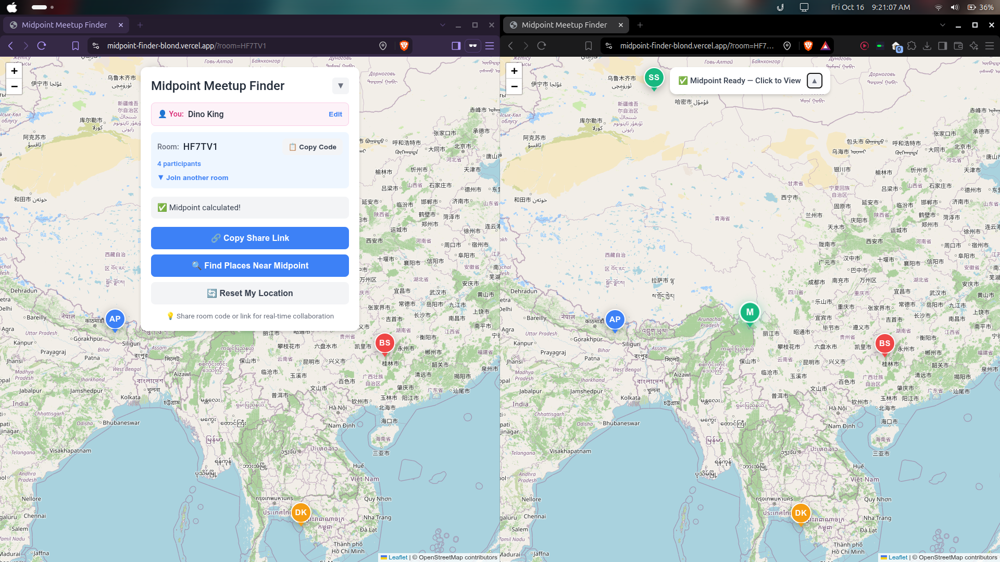
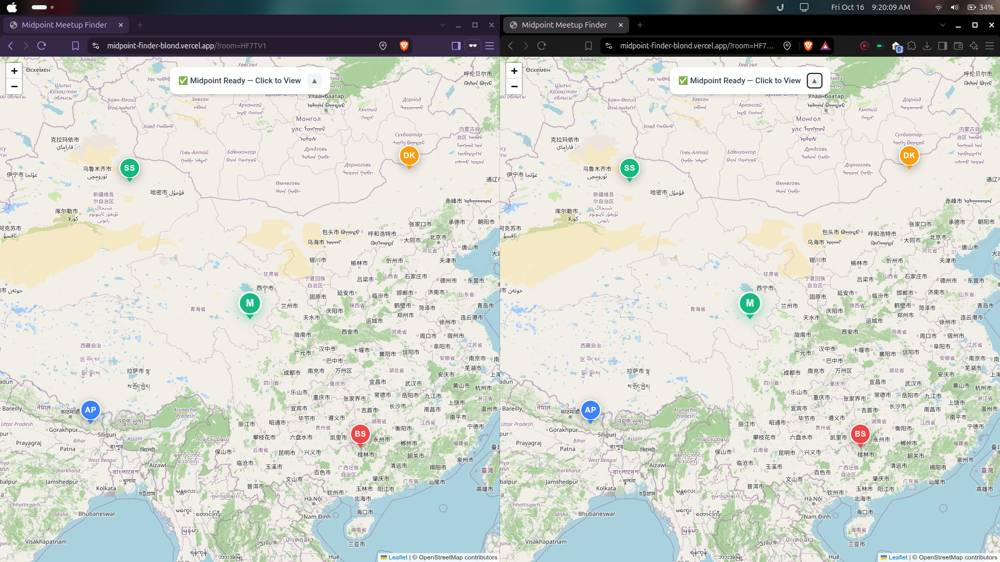

# Midpoint Meetup Finder

A modern, real-time collaborative web application that calculates fair meeting points between two or more friends using actual road networks and geometric centroids. No more travel imbalance debates — find an equitable meetup spot in seconds.

[](https://midpoint-finder-blond.vercel.app)

---

## 📸 Screenshots

| Real-Time Multi-User Sync & Control Panel | Multi-User Midpoint Centroid Calculation |
| :---: | :---: |
|  |  |
| *Expanded Control Panel with custom usernames, 1-click room code copying, smart joiner, and 4 synced participants.* | *Full-map view featuring custom avatar initials pins (AP, BS, DK, SS), collapsible pill UI, and the calculated optimal midpoint (`M`).* |

---

## ✨ Key Features

- **Real-Time Multi-User Collaboration**: Synchronize locations seamlessly across multiple tabs or remote devices in real-time via Supabase PostgreSQL changes and room subscriptions.
- **Custom Avatar Initials Pins**: Beautiful circular markers with distinct color palettes, white borders, drop shadows, and automatic 2-letter uppercase initials (e.g. "John Doe" → `JD`, "Bishal" → `BI`). Hover tooltips reveal full participant names.
- **Network-Aware Routing & Group Centroid**:
  - **2 Participants**: Calculates exact road-network routes via OSRM and places the midpoint marker halfway (50%) along the actual driving route with distance and travel time metrics.
  - **3+ Participants**: Uses Turf.js geometric centroid calculation (`turf.center`) across all participant coordinates.
- **Smart Room Code & URL Parser**:
  - Displays a clean 6-character room code with a one-click `📋 Copy Code` button and full shareable link generator (`🔗 Copy Share Link`).
  - The room joiner accepts either a raw 6-character room code (`HF7TV1`) or a full URL (`https://midpoint-finder-blond.vercel.app/?room=HF7TV1`).
- **Google Maps Integration**: Instant deep-linking to search for cafes, tea spots, or restaurants near the calculated midpoint.
- **Collapsible Glassmorphism UI**: Floating control panel can be minimized into a sleek status pill to maximize map visibility on mobile and desktop without interrupting map panning or zooming.
- **GPS Auto-Location**: Prompts for device geolocation on load with graceful fallbacks.

---

## 🛠️ Tech Stack

- **Frontend**: [React 18](https://react.dev/), [TypeScript](https://www.typescriptlang.org/), [Vite](https://vitejs.dev/)
- **Mapping & GIS**: [Leaflet](https://leafletjs.com/), [React-Leaflet](https://react-leaflet.js.org/), [Turf.js](https://turfjs.org/)
- **Routing API**: [OSRM (Open Source Routing Machine)](http://project-osrm.org/)
- **Real-Time Backend**: [Supabase](https://supabase.com/) (Postgres Realtime Replication)
- **Deployment**: [Vercel](https://vercel.com/)

---

## 🚀 Getting Started

### Prerequisites
- Node.js 18+
- [pnpm](https://pnpm.io/) (preferred) or npm

### Installation & Local Setup

1. **Clone the repository**:
   ```bash
   git clone https://github.com/Bishal-Stha/midpoint-finder.git
   cd midpoint-finder
   ```

2. **Configure environment variables**:
   Create a `.env` file in the project root:
   ```env
   VITE_SUPABASE_URL=https://qvpnbthfguwrzlqgsxrk.supabase.co
   VITE_SUPABASE_ANON_KEY=your_supabase_anon_key
   ```

3. **Install dependencies**:
   ```bash
   pnpm install
   ```

4. **Start the development server**:
   ```bash
   pnpm run dev
   ```
   Open `http://localhost:5173` in your browser.

5. **Build for production**:
   ```bash
   pnpm run build
   ```

---

## 📖 How It Works

1. **Enter Your Name**: Enter or edit your display name in the control panel.
2. **Place Your Pin**: Tap anywhere on the map to pin your location.
3. **Invite Friends**: Click `📋 Copy Code` or `🔗 Copy Share Link` and send it to friends.
4. **Instant Sync**: When friends open the link and place their pins, everyone's map updates in real time.
5. **Meetup & Discover**: The midpoint marker (`M`) appears automatically. Click `🔍 Find Places Near Midpoint` to explore meetup venues directly in Google Maps.

---

## 📄 License

Open-source project licensed under the [MIT License](LICENSE).
